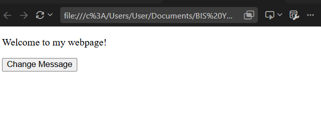
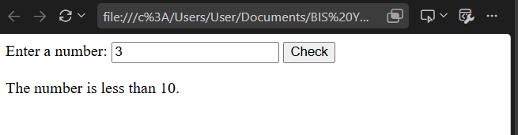
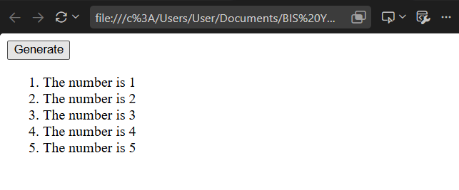

# BIC21203 - Lab 4a: JavaScript

This repository contains the source code and documentation for Lab 4a, focusing on fundamental JavaScript concepts including DOM manipulation, event listeners, conditional statements, input validation, and dynamic element generation.

---

## 👨‍💻 Student Information

* **Name:**Lee Rou
* **Student ID:**AI240160
* **Course:** BIC21203

---

## 📁 Repository Structure

The repository is organized into separate files for each question:

```text
bic21203-lab4a-javascript/
│
├── Q1.html         # Question 1: DOM Manipulation & Event Listener
├── Q2.html         # Question 2: Input Validation & Conditionals
├── Q3.html         # Question 3: Dynamic List Generation
└── README.md       # Repository Documentation
```

---

## 📋 Brief Explanation of Questions

### **Q1: Message Change (DOM Manipulation & Event Listener)**
* **File:** `Q1.html`
* **Explanation:** Demonstrates basic DOM selection and event handling. When the user clicks the "Change Message" button, an event listener triggers a function that targets a paragraph element by its ID and updates its text content from "Welcome to my webpage!" to "Hello there!".

### **Q2: Number Checker (Validation & Conditionals)**
* **File:** `Q2.html`
* **Explanation:** Implements user input validation and conditional logic. It reads a value from a text input, trims whitespace, and checks if it is a valid finite number. Depending on the parsed numeric value, it dynamically displays whether the number is less than 10, greater than 10, equal to 10, or prompts the user to enter a valid number.

### **Q3: Dynamic List Generator (Loops & Element Creation)**
* **File:** `Q3.html`
* **Explanation:** Uses JavaScript loops and dynamic DOM methods to generate content programmatically. When the "Generate" button is clicked, it clears any existing items and uses a `for` loop to create and append five ordered list (`<ol>`) items showing numbers from 1 to 5.

---

## 🚀 Instructions to Run Locally

1. **Clone the repository:**
   ```bash
   git clone https://github.com/leerou0827/bic21203-lab4a-javascript.git
   ```
   *(Or download and extract the ZIP file of the repository)*

2. **Navigate to the repository folder:**
   ```bash
   cd bic21203-lab4a-javascript
   ```

3. **Run the HTML files:**
   * Open any of the files (`Q1.html`, `Q2.html`, or `Q3.html`) directly in any modern web browser (Google Chrome, Mozilla Firefox, Microsoft Edge, etc.) by double-clicking the file or dragging it into the browser window. No server setup is required.

---

## 📸 Output Screenshots

### **Question 1 Output**
(image q1 b.png)

### **Question 2 Output**


### **Question 3 Output**

